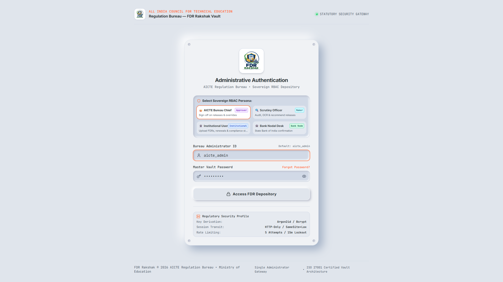
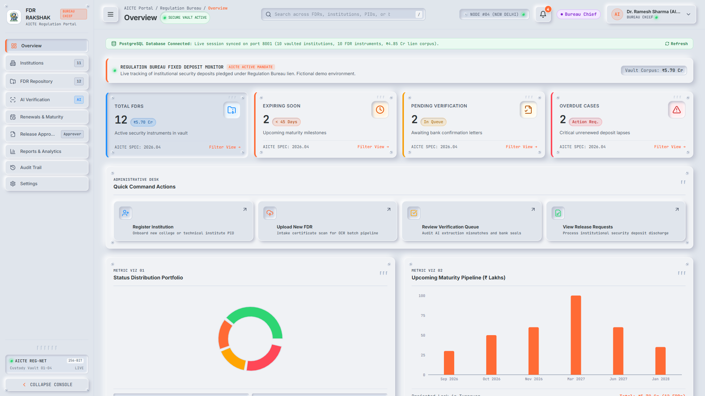
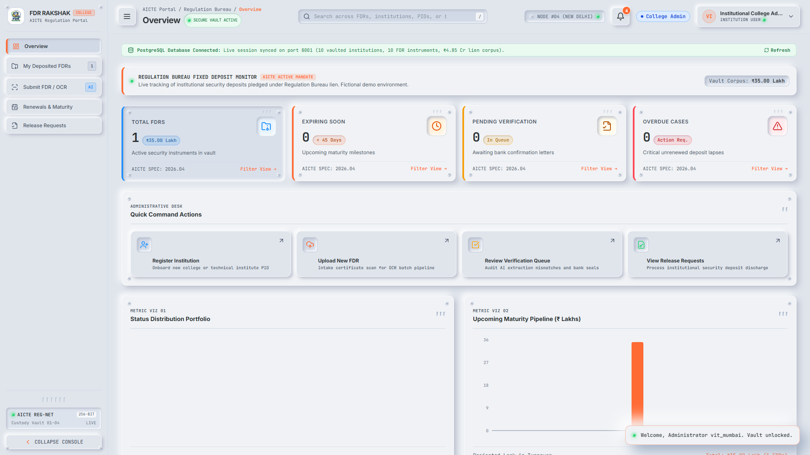
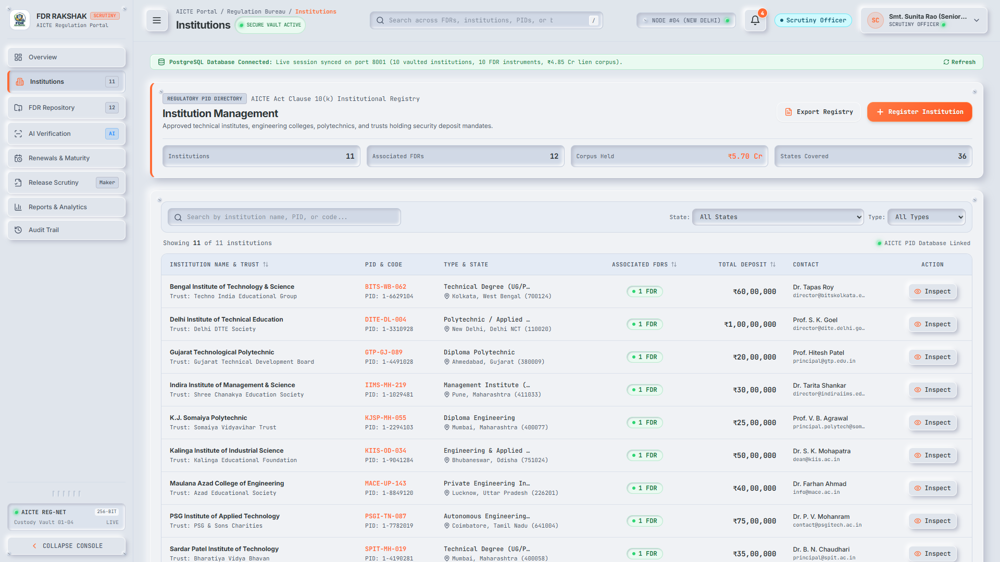
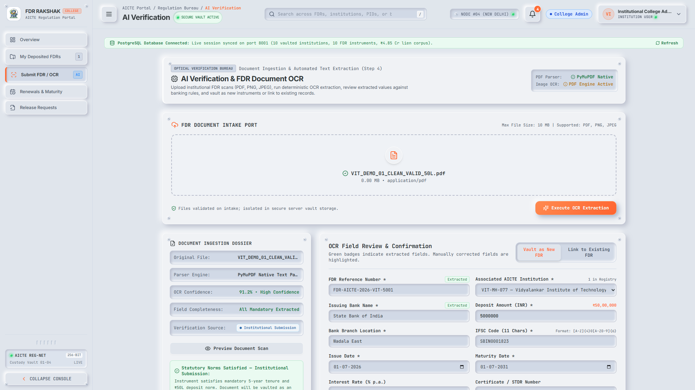
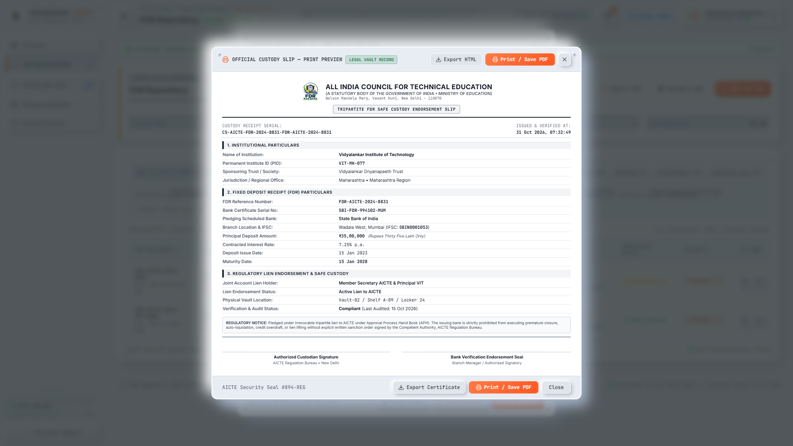
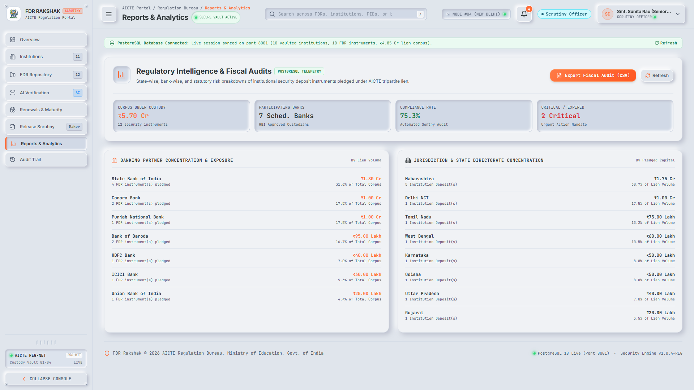
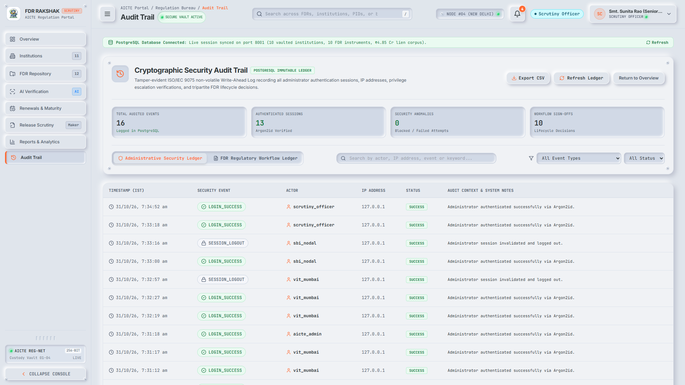
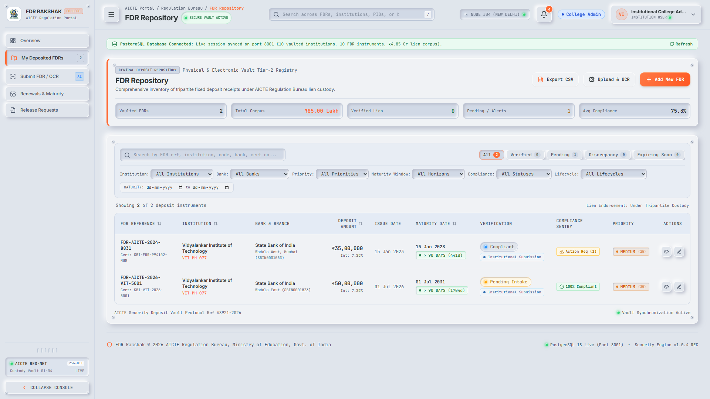

<p align="center">
  
</p>

<h1 align="center">FDR Rakshak</h1>

<p align="center">
  <strong>Statutory Security Deposit & Fixed Deposit Receipt Governance Bureau</strong><br/>
  <em>All India Council for Technical Education (AICTE) • Ministry of Education • Government of India</em><br/>
  <code>SIH 2024 — Problem Statement ID: 26265 — Smart Automation</code>
</p>

<p align="center">
  
  
  
  
  
  
  
</p>

---

## 📋 Table of Contents

- [Problem Statement](#-problem-statement)
- [Our Solution](#-our-solution)
- [Prototype Screenshots](#-prototype-screenshots)
- [System Architecture](#-system-architecture)
- [Key Features](#-key-features)
- [Role-Based Access Control (RBAC)](#-role-based-access-control-rbac)
- [Tech Stack](#-tech-stack)
- [Project Structure](#-project-structure)
- [Getting Started](#-getting-started)
- [API Documentation](#-api-documentation)
- [Security Features](#-security-features)
- [Team](#-team)

---

## 🎯 Problem Statement

> **SIH 2024 — PS ID 26265 (AICTE, Ministry of Education)**
>
> AICTE-approved institutions are required to pledge **Fixed Deposit Receipts (FDRs)** as statutory security deposits under the Approval Process Handbook (APH). Currently, the entire lifecycle — submission, verification, renewal, replacement, and release — is managed through **manual paperwork, scattered spreadsheets, and physical custody records** across thousands of institutions and multiple scheduled banks nationwide.
>
> This leads to:
> - ❌ No centralized digital repository for FDR instruments
> - ❌ Manual verification prone to errors, fraud, and data mismatches
> - ❌ No automated compliance tracking or maturity alerts
> - ❌ Lack of audit trails for regulatory accountability
> - ❌ Delayed processing of release/renewal requests

---

## 💡 Our Solution

**FDR Rakshak** is a full-stack **smart automation platform** that digitizes the entire FDR governance lifecycle for AICTE. It provides:

- 🏛️ A **centralized digital vault** for all institutional FDR instruments backed by PostgreSQL
- 🤖 **AI-powered OCR extraction** (PyMuPDF + Tesseract) to digitize physical FDR certificates with 90%+ confidence
- ✅ An **8-rule explainable compliance engine** that validates every FDR against AICTE statutory norms
- 🔄 **Lifecycle workflow management** for renewals, replacements, and controlled release with maker-checker approval
- 📊 **Real-time analytics dashboard** with banking exposure, state-wise concentration, and maturity pipeline tracking
- 🔒 **Enterprise-grade security** with Argon2id hashing, session-based auth, rate limiting, and immutable audit logs
- 🖨️ **Tripartite custody slip generation** as legally compliant printable documents

---

## 📸 Prototype Screenshots

### 🔐 Authentication Gateway — RBAC Persona Selection
> Sovereign role-based login with 4 distinct personas. Security profile shows Argon2id key derivation, HTTP-Only session transit, and 5-attempt lockout.



---

### 📊 Bureau Chief Command Center
> National-level dashboard showing total FDR corpus (₹5.70 Cr across 12 instruments), maturity pipeline chart, status distribution, and quick command actions.



---

### 🏫 Institutional User Dashboard
> College-specific view showing deposited FDRs, portfolio metrics, action queue, and upcoming maturity milestones.



---

### 🏛️ Institution Registry Management
> Complete AICTE Act Clause 10(k) institutional registry with PID codes, trust details, FDR counts, deposit amounts, and state/type filtering.



---

### 🤖 AI Verification & OCR Extraction
> Upload FDR certificates (PDF/PNG/JPEG) → PyMuPDF native text parsing → OCR confidence scoring → automatic field extraction with validation badges.



---

### ✅ Explainable Compliance Audit Engine
> 8-rule regulatory audit with PASS/FAIL/NEEDS REVIEW verdicts, evidence drill-down for each rule, overall compliance score, and recommended next actions.


---

### 🖨️ Tripartite Custody Endorsement Slip
> Legally compliant printable/exportable custody slip with institutional particulars, FDR details, lien endorsement status, and AICTE regulatory notice.



---

### 📈 Reports & Fiscal Analytics
> Banking partner concentration, state directorate breakdown, compliance rates, and CSV export for fiscal audit by regional offices.



---

### 🔍 Cryptographic Security Audit Trail
> Tamper-evident PostgreSQL-backed immutable ledger logging every authentication, session, workflow decision, and privilege escalation event.



---

### 📁 FDR Repository Vault
> Searchable, filterable central repository of all vaulted FDR instruments with status badges, bank details, maturity dates, and compliance indicators.



---

## 🏗️ System Architecture

```
┌─────────────────────────────────────────────────────────────────────┐
│                        CLIENT (Browser)                             │
│  ┌─────────────────────────────────────────────────────────────┐   │
│  │              React 18 + Vite + Tailwind CSS                  │   │
│  │  ┌──────────┐ ┌──────────┐ ┌──────────┐ ┌──────────────┐   │   │
│  │  │Dashboard │ │   FDR    │ │   OCR    │ │  Compliance  │   │   │
│  │  │ Module   │ │ Vault    │ │ Engine   │ │   Audit      │   │   │
│  │  └──────────┘ └──────────┘ └──────────┘ └──────────────┘   │   │
│  │  ┌──────────┐ ┌──────────┐ ┌──────────┐ ┌──────────────┐   │   │
│  │  │Workflow  │ │ Reports  │ │  Audit   │ │  Settings &  │   │   │
│  │  │ Lifecyle │ │Analytics │ │  Trail   │ │  RBAC Mgmt   │   │   │
│  │  └──────────┘ └──────────┘ └──────────┘ └──────────────┘   │   │
│  └─────────────────────────────────────────────────────────────┘   │
└────────────────────────────────┬────────────────────────────────────┘
                                 │  HTTP REST API (JSON)
                                 │  Session Cookies (HTTP-Only, SameSite)
                                 ▼
┌─────────────────────────────────────────────────────────────────────┐
│                     BACKEND (FastAPI + Uvicorn)                      │
│  ┌─────────────────────────────────────────────────────────────┐   │
│  │                    Security Middleware                        │   │
│  │  X-Content-Type-Options │ X-Frame-Options │ X-XSS-Protection │   │
│  │  Referrer-Policy │ CORS Whitelist │ Rate Limiting             │   │
│  └─────────────────────────────────────────────────────────────┘   │
│                                                                     │
│  ┌────────────┐ ┌────────────┐ ┌────────────┐ ┌──────────────┐   │
│  │   Auth     │ │Institution │ │    FDR     │ │  Document    │   │
│  │  Service   │ │  Service   │ │  Service   │ │  OCR Service │   │
│  │ (Argon2id) │ │ (CRUD+PID) │ │(Lifecycle) │ │(PyMuPDF+Tess)│   │
│  └────────────┘ └────────────┘ └────────────┘ └──────────────┘   │
│  ┌────────────┐ ┌────────────┐ ┌────────────┐ ┌──────────────┐   │
│  │ Compliance │ │    Risk    │ │  Workflow  │ │   Audit      │   │
│  │  Engine    │ │ Scoring    │ │  Engine    │ │   Logger     │   │
│  │ (8 Rules)  │ │(Maturity)  │ │(Maker-Chk) │ │ (Immutable)  │   │
│  └────────────┘ └────────────┘ └────────────┘ └──────────────┘   │
│                                                                     │
│  ┌─────────────────────────────────────────────────────────────┐   │
│  │           SQLAlchemy ORM + Alembic Migrations                │   │
│  └──────────────────────────────┬──────────────────────────────┘   │
└─────────────────────────────────┬───────────────────────────────────┘
                                  │  PostgreSQL Wire Protocol (psycopg3)
                                  ▼
┌─────────────────────────────────────────────────────────────────────┐
│                      PostgreSQL 16+ Database                        │
│  ┌───────────┐ ┌──────────┐ ┌───────────┐ ┌───────────────────┐   │
│  │institutions│ │   fdrs   │ │ documents │ │   admin_users     │   │
│  │(PID,trust, │ │(ref,bank,│ │(file,ocr, │ │(argon2id hash,   │   │
│  │ state,type)│ │ amount,  │ │confidence,│ │  role, lockout,   │   │
│  │            │ │ maturity)│ │ linked_fdr)│ │  institution_id)  │   │
│  └───────────┘ └──────────┘ └───────────┘ └───────────────────┘   │
│  ┌───────────┐ ┌──────────┐ ┌───────────────────────────────────┐ │
│  │ sessions  │ │workflows │ │          audit_logs               │ │
│  │(cookie,   │ │(type,    │ │  (event, actor, IP, timestamp,   │ │
│  │ expiry,   │ │ status,  │ │   context, immutable WAL)        │ │
│  │ admin_id) │ │ maker/   │ │                                   │ │
│  │           │ │ approver)│ │                                   │ │
│  └───────────┘ └──────────┘ └───────────────────────────────────┘ │
└─────────────────────────────────────────────────────────────────────┘
```

---

## ✨ Key Features

| Module | Description |
|:---|:---|
| **🏛️ Institution Registry** | Full CRUD management of AICTE-approved institutions with PID codes, trust details, state mapping, and contact information |
| **📦 FDR Digital Vault** | Centralized repository for all Fixed Deposit Receipt instruments with status tracking, bank details, and maturity monitoring |
| **🤖 AI Document OCR** | Upload FDR certificates (PDF/PNG/JPEG) for automatic text extraction using PyMuPDF + Tesseract with confidence scoring |
| **✅ 8-Rule Compliance Engine** | Explainable regulatory audit: field completeness, date validity, tenure sequence, amount match, reference match, entity match, maturity horizon, document linkage |
| **⚠️ Risk & Maturity Tracking** | Prioritized action queue with risk scoring, approaching maturity alerts, and overdue case flagging |
| **🔄 Lifecycle Workflows** | Maker-checker approval flows for FDR renewal, replacement, and controlled release with justification notes |
| **🖨️ Custody Slip Generation** | Tripartite FDR Safe Custody Endorsement Slips with institutional, banking, and lien details — printable/exportable |
| **📊 Reports & Analytics** | Banking concentration, state-wise breakdowns, fiscal audit exports (CSV), and compliance rate telemetry |
| **🔍 Audit Trail** | Cryptographic immutable ledger of all authentication events, workflow decisions, and administrative actions |
| **⚙️ Governance Settings** | System configuration, database seed management, and administrative controls |

---

## 🔑 Role-Based Access Control (RBAC)

FDR Rakshak implements a **4-persona sovereign RBAC model** reflecting the real-world stakeholders in the FDR governance process:

| Role | Badge | Permissions | Use Case |
|:---|:---|:---|:---|
| **AICTE Bureau Chief** | `Approver` | Full system access, final release approvals, override authority, national reports, governance settings | Senior AICTE official with ultimate sign-off authority |
| **Scrutiny Officer** | `Maker` | Institutions, FDR Repository, AI Verification, compliance audit, release scrutiny (recommend), regional reports, audit trail | AICTE officer who reviews and recommends releases |
| **Institutional User** | `Institutional` | Own institution's FDRs only, submit FDR/OCR, view deposited FDRs, request releases, renewals & maturity tracking | College/polytechnic administrator managing their institution's deposits |
| **Bank Nodal Desk** | `Bank Node` | Bank-specific FDR ledger, upload confirmation letters, discharge desk, verify instruments for assigned bank | Scheduled bank representative confirming FDR custody |

Each persona sees a **tailored sidebar, dashboard, and action set** scoped to their role privileges.

---

## 🛠️ Tech Stack

### Frontend
| Technology | Purpose |
|:---|:---|
| **React 18.3** | Component-based UI with hooks |
| **Vite 5.4** | Lightning-fast dev server & build tool |
| **Tailwind CSS 3.4** | Utility-first responsive styling |
| **Recharts 2.13** | Dashboard data visualizations |
| **Lucide React** | Consistent iconography |

### Backend
| Technology | Purpose |
|:---|:---|
| **FastAPI 0.110+** | High-performance async Python API framework |
| **Uvicorn** | ASGI production server |
| **SQLAlchemy 2.0** | ORM with async support |
| **Alembic** | Database schema migrations |
| **psycopg 3** | PostgreSQL native driver |
| **Pydantic 2.6** | Request/response validation |
| **PyMuPDF (fitz)** | Native PDF text extraction |
| **Pytesseract** | OCR for image-based documents |
| **Pillow** | Image preprocessing for OCR |
| **Argon2id** | Password hashing (via passlib) |

### Database & Infrastructure
| Technology | Purpose |
|:---|:---|
| **PostgreSQL 16+** | Primary relational database |
| **Alembic Migrations** | Version-controlled schema evolution |

---

## 📁 Project Structure

```
FDR-RAKSHAK/
├── backend/                    # FastAPI Backend
│   ├── app/
│   │   ├── config.py          # Environment & security configuration
│   │   ├── database.py        # SQLAlchemy engine & session factory
│   │   ├── main.py            # FastAPI app, lifespan, middleware
│   │   ├── dependencies/
│   │   │   └── auth.py        # Session-based authentication guard
│   │   ├── models/            # SQLAlchemy ORM models
│   │   │   ├── admin.py       # Admin users + password recovery
│   │   │   ├── audit_log.py   # Immutable audit event log
│   │   │   ├── fdr.py         # Fixed Deposit Receipt instrument
│   │   │   ├── institution.py # AICTE-approved institution
│   │   │   ├── session.py     # Server-side session store
│   │   │   └── workflow.py    # Lifecycle workflow records
│   │   ├── routers/           # API route handlers
│   │   │   ├── auth.py        # Login, logout, recovery, session check
│   │   │   ├── audit_logs.py  # Audit trail queries
│   │   │   ├── compliance.py  # 8-rule compliance engine
│   │   │   ├── dashboard.py   # Summary metrics & charts
│   │   │   ├── documents.py   # Upload, OCR, preview, linking
│   │   │   ├── fdrs.py        # FDR CRUD operations
│   │   │   ├── institutions.py# Institution registry management
│   │   │   ├── risk.py        # Risk scoring & prioritization
│   │   │   └── workflows.py   # Renewal/replacement/release flows
│   │   ├── schemas/           # Pydantic request/response schemas
│   │   └── services/          # Business logic layer
│   │       ├── auth_service.py      # Argon2id hashing, RBAC provisioning
│   │       ├── compliance_service.py# 8-rule evaluation engine
│   │       ├── ocr_service.py       # PyMuPDF + Tesseract OCR pipeline
│   │       ├── risk_service.py      # Maturity & risk scoring
│   │       └── workflow_service.py  # Lifecycle state machine
│   ├── migrations/            # Alembic migration scripts
│   ├── tests/                 # Comprehensive test suite
│   │   ├── test_auth_and_security.py
│   │   ├── test_compliance.py
│   │   ├── test_rbac_matrix.py
│   │   └── ...
│   ├── .env.example           # Environment template (safe to commit)
│   ├── alembic.ini            # Migration configuration
│   └── requirements.txt       # Python dependencies
│
├── src/                       # React Frontend
│   ├── App.jsx                # Root component with auth & routing
│   ├── main.jsx               # Vite entry point
│   ├── index.css              # Tailwind directives & custom styles
│   ├── assets/
│   │   └── logo.png           # FDR Rakshak official logo
│   ├── components/            # UI component library
│   │   ├── LoginView.jsx          # RBAC authentication gateway
│   │   ├── Dashboard.jsx          # Role-aware command center
│   │   ├── InstitutionManagement.jsx  # PID registry CRUD
│   │   ├── FdrRepository.jsx      # Digital vault browser
│   │   ├── DocumentUploadOcr.jsx  # AI verification intake
│   │   ├── ComplianceAuditView.jsx    # 8-rule audit display
│   │   ├── LifecycleWorkflowView.jsx  # Renewal/release flows
│   │   ├── ReleaseRequestsView.jsx    # Maker-checker queue
│   │   ├── AuditTrailView.jsx     # Security event ledger
│   │   ├── ReportsAnalyticsView.jsx   # Fiscal analytics
│   │   ├── CustodySlipPrintModal.jsx  # Tripartite document
│   │   ├── Sidebar.jsx           # Role-scoped navigation
│   │   └── ...
│   ├── data/                  # Static reference data
│   │   ├── sampleFdrData.js   # Offline fallback sample data
│   │   └── indiaPinCodes.js   # PIN code lookup database
│   ├── services/
│   │   └── api.js             # Centralized API client
│   └── utils/
│       └── exportUtils.js     # CSV/PDF export helpers
│
├── docs/screenshots/          # README screenshots
├── index.html                 # Vite HTML entry
├── package.json               # Node.js dependencies
├── vite.config.js             # Vite configuration
├── tailwind.config.js         # Tailwind CSS configuration
├── postcss.config.js          # PostCSS configuration
└── .gitignore
```

---

## 🚀 Getting Started

### Prerequisites

- **Node.js** ≥ 18.x
- **Python** ≥ 3.10
- **PostgreSQL** ≥ 14
- **Tesseract OCR** (optional, for image-based OCR)

### 1. Clone the Repository

```bash
git clone https://github.com/Trunal2005/FDR-RAKSHAK.git
cd FDR-RAKSHAK
```

### 2. Database Setup

Ensure PostgreSQL is running, then create a database:

```sql
CREATE DATABASE fdr_rakshak;
```

### 3. Backend Configuration

```bash
cd backend
cp .env.example .env
# Edit .env with your PostgreSQL credentials
```

Edit `backend/.env`:
```ini
DATABASE_URL=postgresql+psycopg://<your_user>:<your_password>@localhost:5432/fdr_rakshak
CORS_ORIGINS=http://localhost:3001,http://127.0.0.1:3001
HOST=0.0.0.0
PORT=8001
ENVIRONMENT=development
```

### 4. Start the Backend (Port 8001)

```bash
cd backend
pip install -r requirements.txt
python -m uvicorn app.main:app --host 127.0.0.1 --port 8001 --reload
```

On first startup, the backend will:
- ✅ Create all database tables automatically
- ✅ Seed sample institutional data (10 institutions, 12 FDR instruments)
- ✅ Provision the initial administrator account
- ✅ Create default RBAC demo users for all 4 personas

### 5. Start the Frontend (Port 3001)

```bash
# From the project root:
npm install
npm run dev
```

### 6. Access the Platform

Open **`http://localhost:3001`** and log in with one of the demo personas:

| Persona | Username | Password |
|:---|:---|:---|
| AICTE Bureau Chief | `aicte_admin` | `AICTE@Admin2026!` |
| Scrutiny Officer | `scrutiny_officer` | `AICTE@Admin2026!` |
| Institutional User | `vit_mumbai` | `AICTE@Admin2026!` |
| Bank Nodal Desk | `sbi_nodal` | `AICTE@Admin2026!` |

> **Note:** These are development-only demo credentials. In production, `ADMIN_INITIAL_PASSWORD` must be explicitly set via environment variable with no hardcoded fallback.

---

## 📡 API Documentation

Once the backend is running, access the interactive API documentation:

- **Swagger UI:** [`http://localhost:8001/docs`](http://localhost:8001/docs)
- **ReDoc:** [`http://localhost:8001/redoc`](http://localhost:8001/redoc)
- **Health Check:** [`http://localhost:8001/api/health`](http://localhost:8001/api/health)

### Key API Endpoints

| Method | Endpoint | Description |
|:---|:---|:---|
| `POST` | `/api/auth/login` | Authenticate and create session |
| `POST` | `/api/auth/logout` | Invalidate session |
| `GET` | `/api/institutions` | List all institutions |
| `GET` | `/api/fdrs` | List all FDR instruments |
| `POST` | `/api/documents/upload` | Upload FDR certificate for OCR |
| `GET` | `/api/compliance/summary` | Run compliance audit |
| `GET` | `/api/risk/prioritized` | Get risk-scored FDR queue |
| `POST` | `/api/workflows/fdr/{id}/renew` | Initiate FDR renewal |
| `POST` | `/api/workflows/fdr/{id}/release` | Request FDR release |
| `GET` | `/api/dashboard/summary` | Dashboard metrics |
| `GET` | `/api/audit-logs` | Query audit trail |

---

## 🔒 Security Features

| Feature | Implementation |
|:---|:---|
| **Password Hashing** | Argon2id (memory-hard, side-channel resistant) |
| **Session Management** | Server-side PostgreSQL sessions with HTTP-Only, SameSite=Lax cookies |
| **Rate Limiting** | 5 failed login attempts → 15-minute account lockout |
| **Security Headers** | `X-Content-Type-Options: nosniff`, `X-Frame-Options: DENY`, `X-XSS-Protection`, `Referrer-Policy` |
| **CORS** | Strict origin whitelist (configurable) |
| **File Upload Security** | 10 MB limit, extension whitelist (.pdf, .png, .jpg, .jpeg), MIME type validation |
| **Audit Logging** | Immutable write-ahead log of all security events with IP, actor, timestamp |
| **Password Recovery** | Time-limited recovery tokens (15 min expiry) |
| **Production Mode** | `SESSION_COOKIE_SECURE=true` auto-enforced, no hardcoded password fallback |

---

## 🧪 Testing

```bash
cd backend
pytest tests/ -v
```

Test coverage includes:
- Authentication & session security
- RBAC permission matrix validation
- Compliance engine rule evaluation
- Dashboard metric aggregation
- Document upload & OCR pipeline
- Workflow state machine transitions
- Configuration security audit

---

## 📊 Compliance Rules Engine — The 8 Regulatory Checks

| # | Rule Code | Validation | Severity |
|:---|:---|:---|:---|
| 1 | `RULE-REQ-FIELDS` | All mandatory statutory fields populated | ❌ Failure |
| 2 | `RULE-DATE-VALIDITY` | Issue and maturity dates are chronologically valid | ❌ Failure |
| 3 | `RULE-DATE-ORDER` | Tenure sequence is within AICTE norms (~5 year minimum) | ⚠️ Warning |
| 4 | `RULE-AMOUNT-MATCH` | Deposit amount cross-validated against OCR scan | ⚠️ Warning |
| 5 | `RULE-REF-MATCH` | FDR reference number matches scanned document | ⚠️ Warning |
| 6 | `RULE-ENTITY-MATCH` | Bank and institution names match across systems | ⚠️ Warning |
| 7 | `RULE-MATURITY-HORIZON` | Maturity date is not approaching within configured threshold | ⚠️ Warning |
| 8 | `RULE-DOC-LINKED` | Physical document scan is linked and verified | 📋 Review |

---

## 👥 Team

Built for **Smart India Hackathon (SIH) 2024** under AICTE, Ministry of Education.

---

## 📄 License

This project is licensed under the **MIT License** — see the [LICENSE](LICENSE) file for details.

---

<p align="center">
  <strong>🇮🇳 Made in India for India's Technical Education Governance 🇮🇳</strong><br/>
  <em>FDR Rakshak — Protecting Every Deposit, Empowering Every Institution</em>
</p>
